# 드라이브메이트

> 도착 시각에 맞춰 달리고, 졸리면 쉬었다 가는 Pleos Connect 앱

현대자동차그룹 차량용 앱 개발 공모전 출품작입니다. 현대차그룹 인포테인먼트 Pleos Connect(Android Automotive OS 기반)에서 동작합니다.

## 세 가지 모드

| 모드 | 이럴 때 | 고르는 것 | 하는 일 |
| --- | --- | --- | --- |
| 온타임 모드 | 약속·픽업·체크인 시각이 정해져 있을 때 | 끝낼 곳(내비 목적지·집·회사·즐겨찾기·최근 목적지), 도착 시각(시각 칩 4개와 ±5분), 남는 시간 쓰는 법(돌면서 맞추기·근처에서 기다리기), 픽업 알림 문자(켜기·끄기) | 남는 시간(목표 시각 − 지금 − 바로 가는 시간 − 여유 3분)을 채운 코스 후보 2~3개. 돌면서 맞추기는 목적지 쪽 경치 지점, 근처에서 기다리기는 목적지 2km(없으면 3km) 안 공원·공영 주차장. 즐겨찾기(학원 픽업 등)는 근처에서 기다리기가 기본. 여유가 35분 넘으면 오래 돌기보다 쉬다 가기를 권하고, 1시간 넘으면 "지금 길이면 오후 8:27에 출발해도 맞아요"처럼 늦게 떠나도 되는 시각도 알려 줌 |
| 롱웨이 모드 | 바로 가기 아쉬울 때(데이트, 퇴근 후 기분 전환) | 더 달릴 시간(+15·30·45·60분), 끝낼 곳, 분위기(데이트·혼자 쉬기), 길(야경·강변·다리·공원·도심 피하기) | 고른 길에 맞는 경치 코스로 돌아 도착. 길은 시각·분위기로 기본값을 정하고(밤이면 야경) 코스 후보 화면 위 칩으로 바꿈. 분위기에 맞춰 무드등 밝기·온도를 바꾸고, 도착하면 무드등을 20초에 걸쳐 천천히 원래대로 |
| 레스트 모드 | 피곤하거나 졸릴 때. 어느 화면에서나 아래 큰 버튼 | 버튼 한 번, 쉬는 방식(눈 붙이기·그냥 기다리기·잠깐 머물기) | 진행 방향 쉴 곳으로 안내(가던 목적지는 그대로 두고 경유지로). 시내에서는 공원·공영 주차장을 먼저 → P단이면 쉬기 시작 → 눈 붙이기는 알람과 깨우기, 기다리기는 출발 시각 알림 → 출발하면 원래 목적지로 다시 안내 |

처음 화면의 '자주 쓰는 설정' 칩(최대 4개)을 누르면 저장해 둔 끝낼 곳·시각·방식(픽업 알림 포함)으로 바로 코스 후보가 나옵니다(학원 픽업 4:50, 집 +30분 같은). 코스 후보 화면의 '이 설정 저장'으로 만들고, 기기에 저장됩니다. 저장한 시각이 조금 전(1시간 안)에 지났으면 그 시각을 그대로 두고 바로 가는 길과 늦는 시간을 보여 줍니다.

### 픽업 알림 (시연 기능)

온타임 모드 설정 화면에서 픽업 알림을 켜면, 픽업할 사람(시연 표본 연락처 '아이')에게 보낼 문자를 세 번 띄웁니다.

1. **곧 도착**: 마지막 구간(남은 경유지 없음)에서 도착까지 3분 남으면 도착 예정 시각, 만날 곳, 지금 차 위치(카카오맵 링크). 마지막 구간이 그보다 짧으면(기다리던 곳이 학원 바로 옆 등) 도착할 때 띄웁니다. 달리는 중 [+10분]으로 더 도는 코스로 바뀌면 마지막 구간에서 다시 띄웁니다.
2. **세운 곳**: 픽업할 곳 300m 안에서 P단으로 세우면 실제로 선 자리(학원에서 몇 m인지와 지도 링크). 조금 옮겨(30m 넘게) 다시 세우면 새 자리를 다시 띄웁니다. 아직 도착으로 보지 않았으면 이때 도착으로 보고, 레스트 모드의 '주차하셨네요'는 묻지 않습니다. 고른 경유지가 아직 남았을 때(학원 앞을 지나 경유지로 가다 잠깐 세움)나 기다릴 곳에 세웠을 때는 띄우지 않습니다.
3. **자리 없음**: 도착 화면의 '자리 없음'을 누르면 진행 방향 오른쪽 앞으로 약 3분 한 바퀴 도는 지점을 경유지로 넣고, 몇 시쯤 다시 오는지 띄웁니다. 도는 동안은 늦어도 길을 줄이지 않고(세울 곳이 없어 도는 것이라) 목표 시각 대비 늦는 만큼만 보여 줍니다. 학원 앞 줄에 오래 서 있어도 도는 길을 지나야 다시 도착으로 보고, 도는 도중 빈자리에 P단으로 세우면 그때 도착으로 보며 내비 경로에서 도는 길을 뺍니다.

띄운 문자는 달리는·도착 화면의 미니맵 아래 '픽업 알림' 카드(말풍선과 띄운 시각)와 오른쪽 안내 기록에 남고, 음성으로 "아이에게 보낼 도착 문자를 띄웠어요"처럼 짧게 알립니다.

**실제로 보내지는 않습니다.** Pleos SDK에 문자 기능이 없고, Android Automotive에서 일반 앱은 연결된 휴대폰으로 문자를 보낼 수 없으며(블루투스 MAP은 시스템 메신저·음성 비서용), 에뮬레이터는 휴대폰과 연결되지 않습니다. 그래서 화면에 '시연 · 실제로 보내지 않음'을 늘 함께 표시합니다. 실제 발송은 Pleos가 메시지 API를 열면 휴대폰 연동 문자로, 아니면 서버 문자 API(발신번호 사전 등록, 키는 서버에 보관)로 붙일 예정입니다(`RestMateController.sendPickup`).

달리는 동안에는 내비의 남은 시간으로 도착 예상을 계속 맞춥니다.

- 도착 예상은 목표 시각 기준으로 보여 줍니다('정각', 계획한 여유 안이면 '4분 여유', 그보다 이르면 '9분 일찍', '약 2분 늦어요'). 분은 화면의 두 시각(도착 예상·목표) 차이로 셉니다. 목표보다 30초 넘게 늦을 것 같은 상태가 1분 30초 이어지면 지금 위치에서 더 짧은 코스로 바꾸고, 그래도 늦으면 경유지를 뺍니다. 기다리는 코스는 기다릴 시간이 3분 밑으로 줄면 들르지 않고 바로 갑니다. 왜 늦는지는 알 수 없으므로 이유를 붙이지 않습니다. 롱웨이 모드는 마감이 느슨해 max(10분, 더 달리기로 한 시간의 1/3)까지는 그대로 두고 '약 N분 더'로만 보여 줍니다.
- 출발할 때 하는 말은 실제 도착 예상과 맞춥니다: 일찍 닿는 코스면 "4시 41분쯤, 9분 일찍 도착해요", 바로 가도 늦으면 "바로 가도 약 4분 늦어요".
- 6분 넘게 일찍 도착할 것 같으면 화면에 '조금 더 돌기'(경치 코스) 또는 '기다렸다 가기'(목적지 근처 공원·공영 주차장)를 띄웁니다. 고른 경유지로 가는 중에는 권하지 않고(바꾸면 고른 곳을 건너뛰게 되므로) 경유지를 지난 뒤에 권합니다. 다 못 채우면 '시간이 맞아요' 대신 '약 6분 일찍 닿아요'라고 씁니다. 권한 코스가 맞지 않게 되면 다른 곳으로 바꾸지 않고 거둡니다. 코스를 고른 뒤 3분, 경로를 바꾼 뒤 10분 안에는 권하지 않고, 졸려서 쉰 뒤에는 쉬다 가는 곳만 권합니다.
- 달리는 중 시간 더하기: 온타임 [+5분][+10분](약속이 늦춰졌을 때, 지금 코스와 같은 종류로 늘어난 시간을 채움. 채울 코스가 없으면 목표만 미루고 몇 분 일찍 닿는지 알림. 기다리는 중에도 눌러 출발 시각을 미룸), 롱웨이 [+15분 더][바로 집으로]('도심 피하기'면 도심을 지나는 코스는 고르지 않음).
- 쉬다 가는(기다리는) 코스는 달리는 화면에 '탄천 공영주차장 4:30 도착 → 4:40 출발'을 보여 주고, 그곳에 P단으로 세우면 출발 시각을 크게 보여 줍니다. 출발 알림은 단계로 합니다: 2분 전 음성 → 출발 시각에 알림음과 음성 → 그래도 그대로 있어 늦기 시작하면 알람(2분 뒤 저절로 멈추고, 출발 알림 뒤 20분까지 5분마다 짧게 다시 알림). 길이 막히거나 풀리면 바로 다시 맞추고, 바뀐 출발 시각과 이유를 화면과 2분 전 음성으로 알립니다. 목적지 바로 옆(300m 안)에서 기다리다 천천히 나가도 출발로 봅니다.
- 온타임 모드 중 레스트 모드로 쉬면 출발 알림을 도착 시각에 맞춥니다. 눈 붙이기는 정한 시간(시내 15분·고속도로 20분)을 그대로 재우고, 그러면 늦어질 때는 얼마나 늦어지는지 한 번 말한 뒤 화면에 '시간에 맞춰 N분만 쉬기'(최소 10분)를 띄워 줄일지는 운전자가 고르게 합니다. 운전자 주의 경고 뒤에는 줄이기를 권하지 않고 늦어지는 만큼만 알립니다. 시간이 남으면 "1시 13분에 깨우고 2시 3분에 출발"처럼 깨운 뒤에도 출발 시각을 알려 줍니다. 눈 붙이는 화면에도 [+5분][+10분]이 있어 약속이 늦춰지면 도착 목표를 미룹니다.
- 졸려서 쉬는 중(레스트 모드 안내로 옴)에 '그냥 기다리기'로 바꿔도 10분(주의 경고 뒤면 기본 휴식 시간)은 출발을 재촉하지 않습니다. 졸려서 쉰 휴식은 늦더라도 알람을 울리지 않고, 출발 시각에 "충분히 쉬셨으면 천천히 출발해 주세요"만 합니다. 조금만 쉬고 떠나면 다시 졸릴 때 레스트 모드를 누르라고 일러 둡니다.
- 깨우는 시간은 쉰 시간의 절반, 최대 10분입니다(5분 미만으로 쉬었으면 없음). 알람을 3분 넘게 못 듣고 잤으면 알람을 끈 때부터 다시 셉니다.
- 쉼터로 안내받는 동안에는 시간 맞추기를 멈추고 고른 경유지는 남겨 둡니다. 안내를 취소하면 원래 코스로 돌아갑니다. 계획한 곳에서 쉬었으면 경유지를 지난 것으로 보고, 다른 곳에서 쉬었으면 다시 출발할 때 경유지가 아직 맞으면 그대로 거쳐 갑니다(롱웨이 모드는 늘, 졸려서 쉬었으면 경치 경유지는 뺌). 어느 쪽인지 화면과 음성으로 알립니다.
- 목적지가 가장 가까운 쉼터만큼 가까우면 쉼터 대신 "목적지까지 약 4분이에요. 도착하면 꼭 쉬어 가세요"라고 합니다. 목적지까지 30분이 안 남았으면 휴식 공백 안내·2시간 알림 카드를 띄우지 않고(떠 있던 카드도 지움), 도착한 뒤에도 묻지 않습니다.

음성은 모드에 따라 줄입니다: 안전 안내는 늘 말하고, 온타임은 출발·경로 변경·늦음(2분 넘게 늦을 때 처음 한 번)·도착을, 일찍 도착 권유는 화면으로만. 롱웨이 모드 데이트는 말하지 않고, 혼자일 때는 경로가 바뀔 때만 시각 없이 짧게 말합니다(출발·도착은 말하지 않음).

안전장치: 운전자 주의 경고가 켜지면 바로 가장 빨리 닿는 쉴 곳으로 안내하고, 연속 주행 2시간이면 쉬어 가기를 묻습니다. 음성 안내는 기기의 Android TTS로 하며, 말한 내용은 화면 아래 자막(14초)과 오른쪽 '안내 기록'(시각과 함께)에도 남습니다.

## 화면

가로형 차량 화면을 두 칸으로 나눕니다. 왼쪽은 운전자가 보는 내용, 오른쪽은 앱이 지금 무엇을 알고 무엇을 했는지입니다.

색과 형태는 현대자동차 디자인 시스템(KR 제품 화면)을 차 안에 맞춰 옮겼습니다: Pleos Connect 화면처럼 흰 면·옅은 회색 바탕에 남색 글자, 액티브 블루(#007FA8)·스카이 블루(#00AAD2) 강조, 각진 버튼과 평평한 면. 모드 카드는 현대 네이비(#002C5F) 배너로 둡니다. 롱웨이 모드는 샌드색으로 구분하고, 레스트 모드·주의는 안전 경고라 호박색을 그대로 씁니다. Hyundai Sans는 라이선스 받은 파일이 없어 시스템 글꼴을 쓰고 굵기·자간만 맞췄습니다.

차가 야간 모드가 되면(시스템 다크 모드) 네이비를 어둡게 내린 밤 화면으로 바뀝니다. 밤 운전에 흰 화면이 눈부시지 않게 하려는 것이고, 같은 색 이름이 낮·밤에서 같은 뜻을 갖도록 두 벌을 맞췄습니다(`ui/Theme.kt`).

- **왼쪽 위**: 지금 모드와 단계(① 설정 › ② 코스 › ③ 주행 › ④ 도착), 지금 시각
- **왼쪽 가운데**: 넓은 화면이면 조작·숫자 | 미니맵 두 칸
  - **미니맵**: OpenStreetMap 지도(한글 지명) 위에 지나온 길(회색), 갈 길(모드 색), 코스 후보 번호(카드 번호와 같은 색), 경유지, 쉼터(P), 목적지, 진행 방향을 가리키는 차. 경로선·지나온 길·차는 실제 도로 모양(OSRM 길찾기)을 따라 그립니다. 달리는 중에는 차를 아래쪽 가운데 두고 진행 방향이 위로 오는 **주행 화면**으로, 코스를 고르거나 서 있을 때·도착하면 북쪽이 위인 **전체 보기**로 바뀝니다. 인터넷이 안 되면 격자 바탕에 곧은 선으로 그대로 보입니다.
  - 시연의 모의 차는 시간 계산을 단순하게 두려고 지점 사이를 곧게 달리고, 화면에는 같은 진행 비율만큼 도로를 따라간 자리에 그립니다. 도중에 경로가 바뀌면 화면에 그린 자리(도로 위)에서 달리던 방향 그대로 이어 그립니다.
  - **도착 시각 막대**: 출발부터 목표까지의 시간 위에 지금 · 도착 예상 · 목표(깃발) · 들렀다 가는 곳. 목표 앞 3분은 여유 구간(하늘색), 목표 뒤는 늦음 구간(호박색). 늦을 것 같으면 "지켜보는 중 · N초 뒤에도 늦으면 더 짧은 길로"처럼 지금 하는 일을 한 줄로 알려 줍니다.
  - **쉬는 시간표**: 눈 붙이기 → 깨우기 → (기다리기) → 주행 → 도착, 그리고 목표
- **왼쪽 아래**: 음성 안내 자막, 늘 있는 '레스트 모드' 버튼
- **오른쪽**: 기어·속도·연속 주행, 차량·내비 SDK와 음성 연결 상태, 안내 기록(음성·내비 요청·차량 제어·시연 조작을 시각과 함께), 시연 조작

화면 표본은 `ui/PreviewData.kt`에 있고, Android Studio 미리보기와 CI의 화면 캡처(Screen snapshots 작업의 `screens` 아티팩트)가 같은 표본을 씁니다. 아래는 그 캡처입니다(시연 모드, 1696×1180dp, 낮 화면. 9·10번은 밤 화면).

| 처음 화면 | 코스 고르기 (온타임) |
| --- | --- |
| 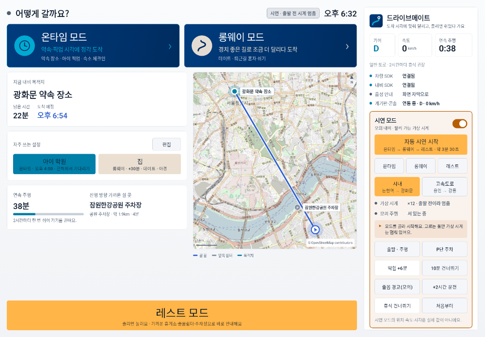 | 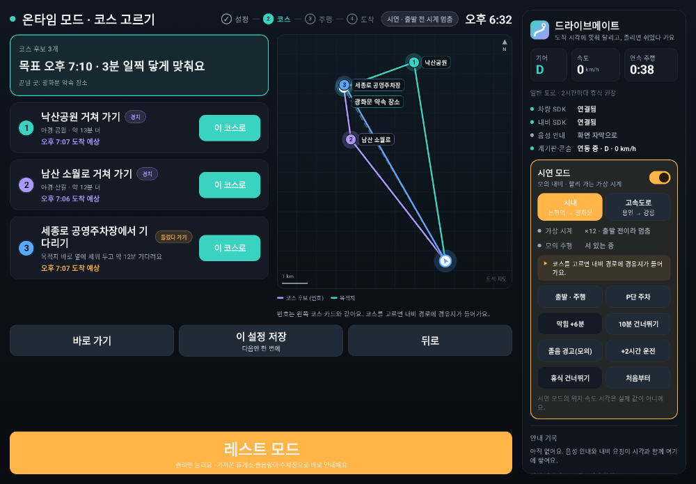 |
| **달리는 중**: 도착 시각 막대·코스 목록·주행 화면 미니맵·음성 자막 | **막혀서 늦을 것 같을 때**: 1분 30초 지켜본 뒤 더 짧은 길로 |
| 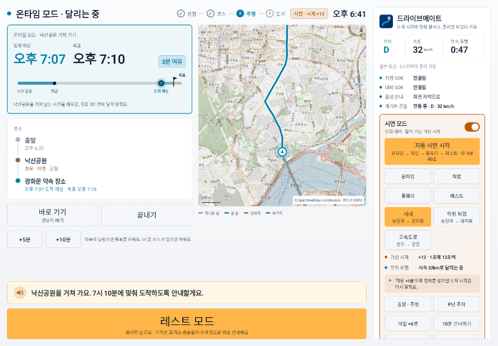 | 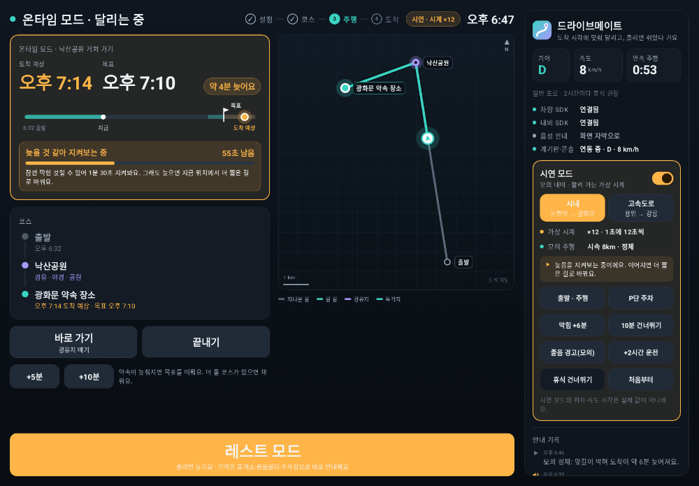 |
| **레스트 모드**: 가장 빨리 닿는 쉼터로 안내 | **휴식**: 오후 3시 체크인에 맞춘 알람·출발 |
| 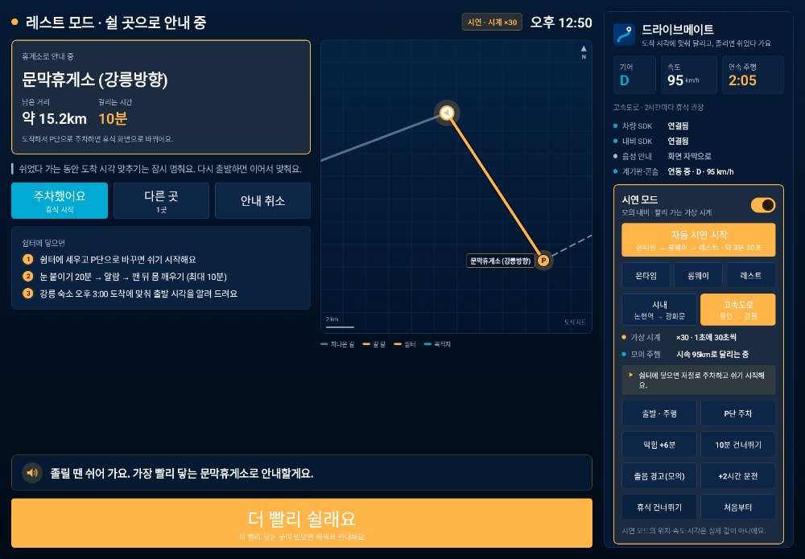 | 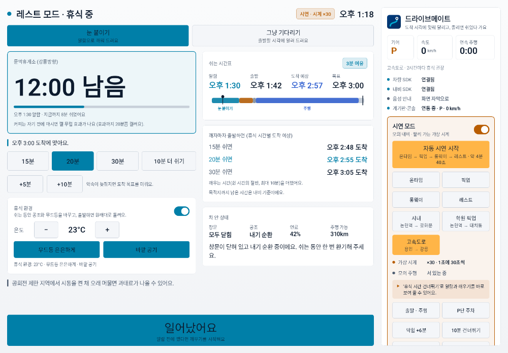 |
| **자동 시연**: 화면 위 해설과 장면 번호 | **자동 시연**: 누르기 전에 버튼을 짚어 보여 줌 |
| 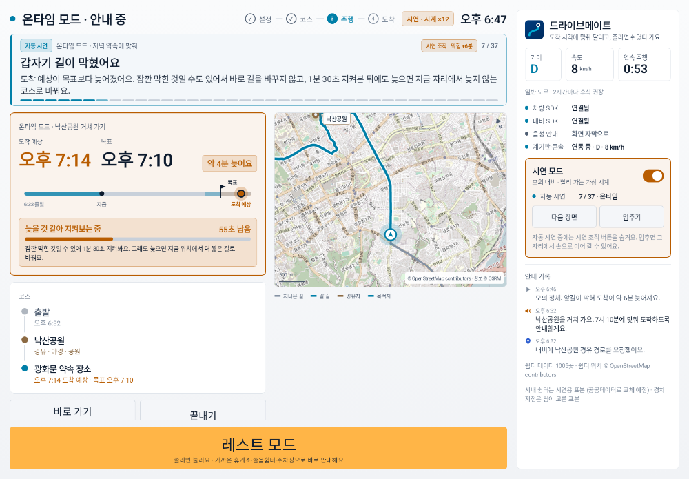 | 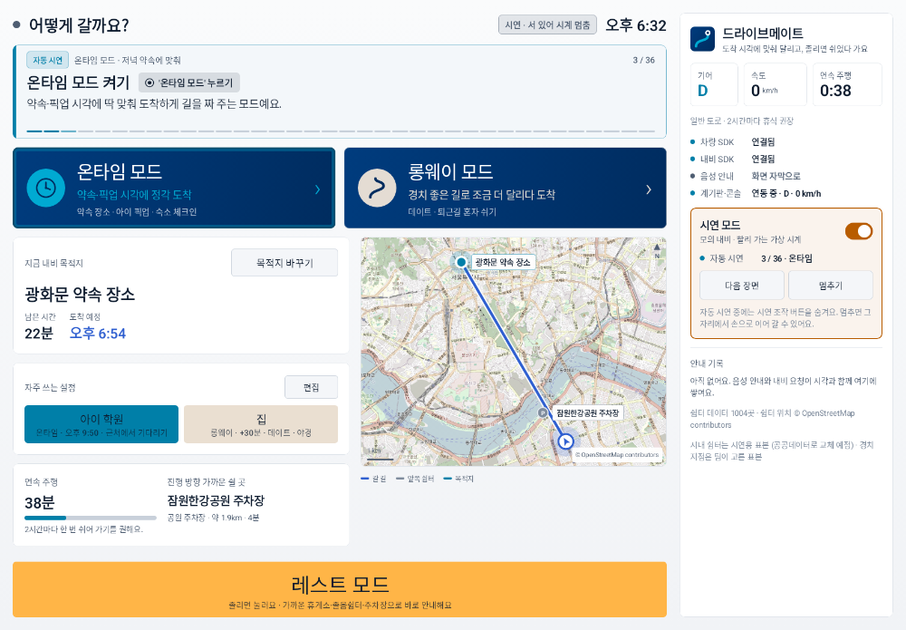 |
| **밤 화면**: 차가 야간 모드일 때 (달리는 중) | **밤 화면**: 쉼터 안내 |
| 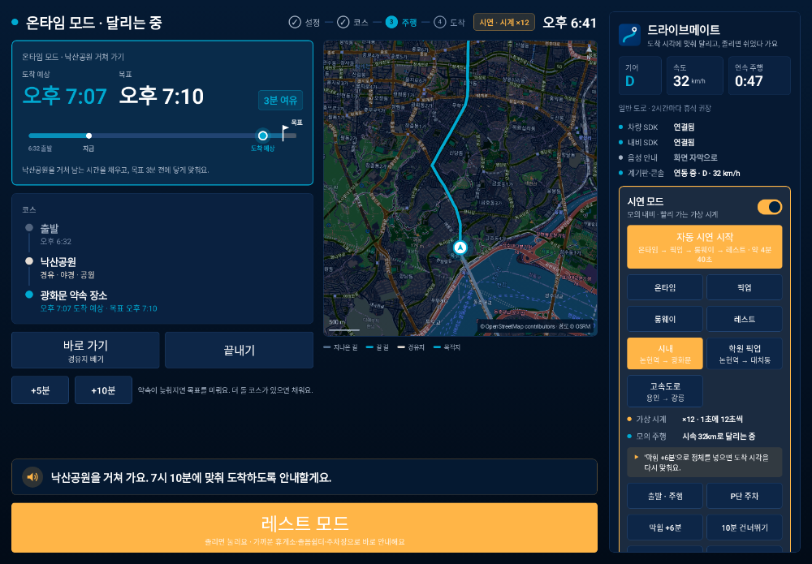 | 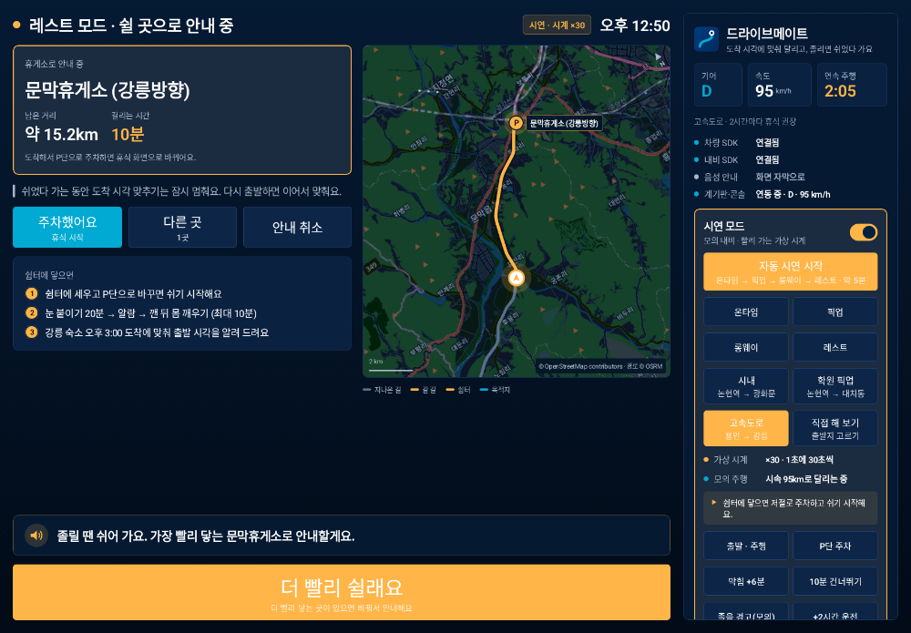 |
| **픽업 알림**: 도착 3분 전 문자 (자동 시연 해설과 함께) | **픽업 알림**: 자리 없어 한 바퀴 돌고 와서 세운 곳을 다시 보냄 |
| 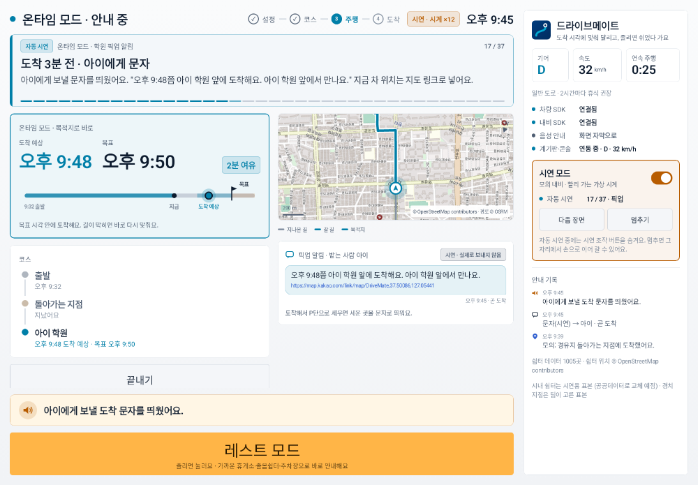 | 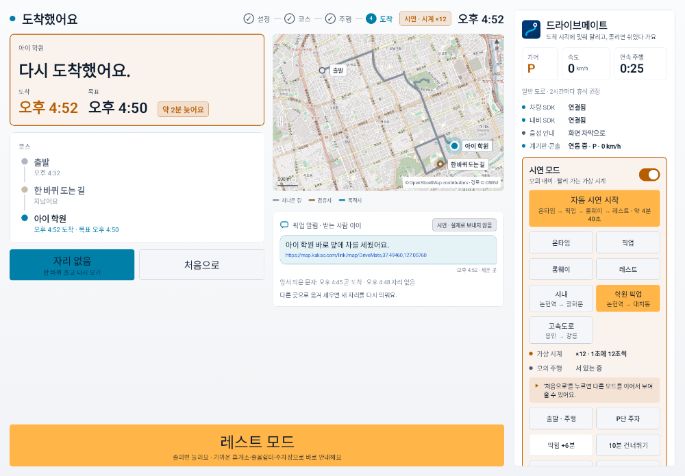 |

## 쓰는 SDK

| 기능 | SDK |
| --- | --- |
| 지금 위치·목적지·남은 시간, 경유지 넣은 경로 요청, 바로 가는 시간(경로 조회), 즐겨찾기·최근 목적지, 경유지·도착 알림 | NaviHelper 3.0.5 |
| 기어(휴식 시작·출발), 경고등(운전자 주의 경고), 공조·무드등 제어(휴식·깨우기·분위기) | Vehicle 2.3.2 |
| (시연 모드에서만) 모의 차량의 기어·속도를 계기판·3D 주행 화면에 맞추기 | 에뮬레이터 Virtual Console (127.0.0.1:8088) |
| 미니맵 바탕 지도 | OpenStreetMap 표준 타일 (tile.openstreetmap.org, 키 없음) |
| 미니맵 경로 모양 (화면에 그리는 데만) | OSRM 길찾기 (router.project-osrm.org, 키 없음) |
| 픽업 알림 문자 | 시연 기능: 보낼 문자를 화면·안내 기록에만 남김 (Pleos SDK에 문자 기능 없음). 위치는 카카오맵 링크(`map.kakao.com/link/map/이름,위도,경도`)로 넣음 |

인터넷은 에뮬레이터 안의 Virtual Console(127.0.0.1)과 미니맵 지도 타일·경로 모양(HTTPS)에만 씁니다. 평문 통신은 127.0.0.1·localhost만 허용합니다(`res/xml/network_security_config.xml`).

## 실행 방법

1. Pleos Connect Emulator v2.1.0 AVD를 실행합니다. 설치 방법은 [docs/SETUP.md](docs/SETUP.md)에 있습니다.
2. APK를 설치합니다.

   ```bash
   adb install -r apk/팀명_앱이름_release.apk
   ```

3. 런처에서 '드라이브메이트'를 실행합니다.

소스에서 바로 실행하려면 Pleos Connect AVD를 켠 상태에서 `./gradlew installDebug`를 실행합니다.

## 시연 모드 (PT용)

화면 오른쪽 '시연 모드'를 켜면 실제 차량·내비 신호 대신 모의 내비와 빨리 가는 가상 시계를 씁니다(화면 위에 '시연 모드'로 표시). 출발 상황은 셋 중에 고릅니다.

- **시내**: 논현역에서 광화문 약속 장소로(내비 목적지가 이미 걸려 있음, 약 20분 거리). 가상 시계 12배, 오후 6시 30분에서 시작(퇴근길 저녁 약속).
- **학원 픽업**: 논현역에서 대치동 학원으로(내비 목적지가 학원, 약 9분 거리). 가상 시계 12배, 오후 4시 30분에서 시작(매일 4시 50분 픽업, 바로 가면 10분쯤 일찍).
- **고속도로**: 용인에서 강릉 숙소로. 가상 시계 30배, 오전 11시 40분에서 시작.

가상 시계는 D단으로 서 있는 동안(출발 전) 멈춰 있다가 **출발 · 주행**을 누르면 흐릅니다. 그래서 모드·코스를 고르며 설명하는 동안 남는 시간이 줄거나 코스 후보가 바뀌지 않고, 연속 주행 시간도 늘지 않습니다. 오른쪽 시연 카드에 시계 상태(×12 · 출발 전이라 멈춤)와 다음에 누를 것이 한 줄로 나옵니다.

### 자동 시연 (영상 녹화용)

오른쪽 시연 카드의 **자동 시연 시작**을 누르면 앱이 네 이야기를 약 4분 40초 동안 스스로 진행합니다. 누르는 사람 없이 같은 흐름이 나와서 시연 영상을 찍을 때 씁니다.

1. **온타임** (시내): 7시 10분 광화문 약속 → 온타임 모드 → 코스 찾기 → 1번 코스 → 출발 → 막힘 +6분 → 1분 30초 지켜본 뒤 늦지 않는 코스로 바꿈 → 빨리 감아 도착
2. **픽업** (학원 픽업): 오후 4시 30분 논현역, 4시 50분 대치동 학원 픽업 → 온타임 모드(끝낼 곳은 내비에 걸린 '아이 학원', 돌면서 맞추기) → 픽업 알림 켜기 → 코스 찾기 → 1번 코스 → 도착 3분 전 문자 → 학원 앞 도착 → **자리 없음** → 한 바퀴 돌고 다시 도착 → P단 주차 → 세운 곳 문자
3. **롱웨이** (시내): 퇴근길 집으로 → 롱웨이 모드(30분 더, 저녁이라 야경) → 코스 찾기 → 1번 코스 → 출발 → +15분 더
4. **레스트** (고속도로): 강릉 숙소로 50분쯤 달린 뒤 **레스트 모드** → 가장 빨리 닿는 쉼터로 안내 → 닿으면 자동 P단·눈 붙이기 → 알람 → 알람 끄기·몸 깨우기 → 출발할게요 → 강릉 숙소로 다시 안내

- 화면 위에 지금 장면의 해설(몇 번째 장면인지, 무슨 상황인지)이 뜹니다. 해설에 나오는 코스·시각·쉼터 이름은 그때 실제로 나온 값입니다.
- 앱 버튼을 누르기 전에 그 버튼을 흰 테두리로 1.6초 짚어 보여 줍니다(모드 카드·코스 찾기·이 코스로·+15분 더·픽업 알림 켜기·자리 없음·화면 아래 큰 버튼). 시연에서만 하는 조작(출발 · 주행, 막힘, 시간 건너뛰기, P단 주차)은 해설 위에 '시연 조작'으로 표시합니다.
- 이야기 하나만 보려면 **온타임**·**픽업**·**롱웨이**·**레스트**. 진행 중에는 **다음 장면**·**멈추기**가 있고, 멈추면 그 자리에서 손으로 이어 갈 수 있습니다. 진행 중에는 손으로 누르는 시연 조작 버튼을 숨깁니다.
- 대본은 `app/AutoDemo.kt`에 있고, 실제 엔진으로 끝까지 돌려 모든 장면이 시간 초과 없이 넘어가는지 시험합니다(`AutoDemoScriptTest`).

녹화는 에뮬레이터 창만 잡으면 됩니다: Windows는 에뮬레이터 창을 누른 뒤 **Win + Alt + R**(Xbox Game Bar, 그 창만 녹화), 콘솔(3D 주행 화면)까지 함께 담으려면 OBS의 창 캡처를 두 개 놓습니다. 시작하기 전에 계기판·콘솔 연동(아래)을 켜 두면 기어·속도도 함께 움직입니다.

### 계기판·3D 주행 화면과 같이 보여 주기

시연 모드에서는 모의 차량의 기어(P·D)와 속도를 에뮬레이터의 Virtual Console에 보내, 계기판과 콘솔의 3D 주행 화면(DRIVING VISUALIZATION)이 앱의 모의 주행과 같이 움직입니다. 오른쪽 패널 '계기판·콘솔'에 연동 상태가 나옵니다.

1. 에뮬레이터를 켜고 PC 터미널에서 한 번 실행합니다.

   ```bash
   adb forward tcp:8088 tcp:8088
   ```

2. PC 브라우저에서 `http://127.0.0.1:8088`을 열어 에뮬레이터 창 옆에 둡니다.
3. 앱에서 시연 모드를 켜고 **출발 · 주행** / **P단 주차**를 누르면 콘솔의 기어·속도가 따라 바뀝니다. 시연 모드를 끄면 P단·0km/h로 돌려 둡니다.

콘솔이 없으면(실차·일반 기기) '연결 안 됨'으로만 표시하고 시연은 그대로 됩니다.

장면별 순서 예시:

1. **약속 20분 일찍** (시내): 온타임 모드 → 끝낼 곳 '광화문 약속 장소', 시각 칩으로 목표 확인 → 코스 찾기 → 여의도한강공원·북악스카이웨이 팔각정 같은 후보 중 하나 → **출발 · 주행**. 중간에 **막힘 +6분**을 누르면 1분 30초 지켜본 뒤 늦지 않게 더 짧은 코스로 바꿉니다. '바로 가기'로 출발하면 3분 뒤 일찍 닿는 만큼 화면에 '조금 더 돌기'가 뜹니다.
2. **학원 픽업** (시내): 온타임 모드 → 끝낼 곳 '아이 학원'(즐겨찾기라 '근처에서 기다리기'가 기본) → 시각 칩 → **아이에게 보내기**(픽업 알림) → 코스 찾기 → **이 설정 저장** → '탄천 공영주차장에서 기다리기' → 주행. 주차장에 닿으면 자동으로 P단 → 큰 글씨로 출발 시각, 2분 전 음성 → 출발 시각에 알림음 → **출발할게요**. 기다리는 동안 수업이 늦게 끝나면 **+10분**으로 출발 시각을 미룹니다. 학원까지 3분 남으면 아이에게 도착 시각 문자, 학원 앞에서는 세울 곳이 있으면 **P단 주차**(세운 곳 문자), 없으면 **자리 없음**(한 바퀴 돌고 다시 오는 시각 문자). 픽업 알림을 켠 드라이브는 시연에서 목적지에 닿아도 바로 P단으로 세우지 않고 멈춰 서서 둘 중 하나를 기다립니다. 다음부터는 처음 화면의 칩 한 번으로 같은 설정.
3. **데이트·퇴근길** (시내): 롱웨이 모드 → +30분, 분위기 고르기 → 코스 찾기 → 위 칩으로 야경·강변·다리·공원·도심 피하기 → 주행. 달리는 중 **+15분 더**나 **바로 집으로**. 데이트 분위기면 말하지 않고 화면으로만 알립니다. 실내 분위기는 차량 연결 시에만 바뀝니다.
4. **휴게소에 들러 시간 맞추기** (고속도로): 온타임 모드 → 시각 칩 오후 3:00(먼 길이라 칩이 1시간 간격) → '둔내휴게소에서 쉬다 가기' → 주행(필요하면 **10분 건너뛰기**). 휴게소에서는 출발 시각을 알려 주고, '눈 붙이기'로 바꾸면 20분 뒤 깨운 다음 출발 시각(예: 2:03)을 다시 크게 보여 주고 그때 알려 줍니다. 기다리는 중 **막힘 +6분**을 누르면 출발 시각이 당겨집니다.
5. **잠깐 쉬고 싶을 때**: 어느 화면에서나 **레스트 모드** → 진행 방향 쉴 곳(시내는 공원·공영 주차장 먼저)으로 안내 → 닿으면 자동 P단 → 눈 붙이기(시내 15분·고속도로 20분. 온타임 중 그대로 자면 늦을 때는 몇 분 늦는지 알리고, '시간에 맞춰 N분만 쉬기'를 누르면 줄여서 깨움). '안내 취소'를 누르면 원래 코스로 돌아갑니다.
6. 그 밖에 **졸음 경고(모의)**(바로 쉴 곳 안내), **+2시간 운전**(연속 주행 알림), **P단 주차**(안내 없이 세우면 [그냥 기다리기]/[눈 붙이기], 롱웨이 모드면 [잠깐 머물기]/[눈 붙이기]).

## Virtual Console로 확인하기

시연 모드를 끄면 실제 차량·내비 신호를 씁니다.

- 내비에서 목적지를 정하면 처음 화면에 남은 시간이 나오고, 온타임 모드에서 그 목적지를 고를 수 있습니다.
- 내비 즐겨찾기(집·회사)와 최근 목적지가 끝낼 곳 후보로 나오는지
- 코스를 고르면 내비 경로가 경유지를 넣어 바뀌는지, 경유지·목적지 도착 알림이 오는지
- 기어 P ↔ D: 휴식 시작·출발 판단
- 경고등 DRIVER_ATTENTION 켜기: 바로 쉴 곳 안내
- 휴식 중·롱웨이 모드 중 공조(온도·바람·내외기)와 무드등이 바뀌는지, 끝나면 원래대로 돌아오는지

## 테스트 환경

| 항목 | 버전·설정 |
| --- | --- |
| 에뮬레이터 | Pleos Connect Emulator 2.1.0 (API 34 system image), RAM 4 GB, Cold boot |
| Vehicle SDK | 2.3.2 |
| NaviHelper SDK | 3.0.5 |
| 빌드 | JDK 17, Gradle 8.10.2, Android Gradle Plugin 8.8.2, Kotlin 2.0.0 |
| minSdk / targetSdk | 28 / 35 |
| 화면 | 가로형. 앱 영역 1700×1180dp 안팎에서 두 칸 배치, 1280×720dp에서도 깨지지 않는지 화면 캡처로 확인 |

## 알려진 한계

- 경로 모양은 SDK로 받을 수 없어, 코스 후보를 고를 때 직선거리 × 우회 계수로 추정합니다. 고른 뒤에는 내비 남은 시간으로 계속 고칩니다. 미니맵의 도로 모양은 OSRM에서 받아 그리는 것이라 차 내비가 실제로 안내하는 길과 다를 수 있습니다.
- 경로별 정체 정보는 받을 수 없어 '덜 막히는 길'은 만들지 않았습니다. 실제 정체는 달리는 중 내비 남은 시간으로 반영합니다.
- 경치 지점(23곳)과 시내 쉴 곳(공원·공영 주차장 13곳)은 서울·강릉 일부의 시연용 표본이며 좌표는 대략 위치입니다. 그래서 '근처에서 기다리기'와 '+15분 더'가 곳에 따라 다 채우지 못할 수 있고, 그때는 "이 근처는 최대 N분 코스예요"처럼 알려 줍니다. 공공데이터(전국주차장정보표준데이터·도시공원정보표준데이터)로 바꿀 예정입니다.
- Vehicle SDK에 차속 API가 없어 내비 위치 변화로 속도를 추정합니다.
- 경고등이 켜지는 방식과 차량 제어 지원 범위는 차종마다 달라 에뮬레이터·실차에서 확인이 필요합니다. 차량 제어 권한은 앱마켓 입점 때 승인이 필요합니다.
- 말로 입력은 Pleos 음성 인식 SDK가 준비되면 붙입니다. 지금은 큰 버튼으로 고릅니다.
- 픽업 알림 문자는 실제로 보내지 않습니다(위 '픽업 알림' 참고). 받는 사람도 시연 표본('아이')이고, 실제 차량 모드에서는 휴대폰 연락처를 받기 전이라 '동승자'로 표시합니다.
- '자리 없음'의 한 바퀴 도는 지점은 목적지에서 진행 방향 오른쪽 앞으로 계산한 점이라(250~900m) 골목·단지 안일 수 있습니다. 실제 길은 내비가 그 점 가까운 도로로 잇습니다.

## 데이터 출처

- 휴게소·졸음쉼터 위치: © OpenStreetMap contributors, [ODbL](https://opendatacommons.org/licenses/odbl/1-0/). 가공 방법은 `app/src/main/assets/rest_areas_LICENSE.txt`에 있습니다. 앱이 읽을 때 퀵서비스·주유소·정비소처럼 쉴 수 없는 항목과 도심에 잘못 찍힌 휴게소를 거르고(1,119곳 중 68곳), 같은 곳이 두 번 올라 있으면 하나로 합칩니다(58곳). 회사 이름·지역 이름뿐인 항목은 300m 안에 제대로 된 이름의 같은 곳이 있으면 뺍니다(2곳). 그래서 991곳을 씁니다 (`core/RestAreaCleaner.kt`).
- 경치 지점·시내 쉴 곳: 팀이 고른 시연용 표본 (`app/src/main/java/kr/contest/pleosapp/data/CourseCatalog.kt`).
- 미니맵 경로 모양: OSRM 길찾기 서버(OpenStreetMap 데이터). [이용 정책](https://github.com/Project-OSRM/osrm-backend/wiki/API%20Usage%20Policy)에 따라 앱 이름을 밝힌 User-Agent로 1초에 한 번까지만 묻고, 받은 길은 기기에 저장해 다시 묻지 않으며, 지도에 출처를 표시합니다(`ui/RoadRoutes.kt`).
- 미니맵 지도: © OpenStreetMap contributors. [OSM 타일 이용 정책](https://operations.osmfoundation.org/policies/tiles/)에 따라 앱 이름을 밝힌 User-Agent로 미니맵 한 장에 필요한 타일만 받고, 받은 타일은 기기에 7일 저장해 다시 받지 않으며, 지도 오른쪽 아래에 출처를 표시합니다(`ui/MapTiles.kt`). 앱마켓 출시 때는 상용 지도 타일(네이버 지도 등)로 바꿀 예정입니다.

## APK 위치

- `apk/팀명_앱이름_release.apk`
- 용량이 커서 저장소에 못 올리면 GitHub Releases 링크로 대체합니다.

## 팀

심사 자료 안내(공유 링크·첨부에 개발자 실명을 쓰지 않음)에 따라 이름 대신 역할만 적습니다. 팀원 정보는 참가신청서에 있습니다.

| 팀원 | 역할 |
| --- | --- |
| A | PM(일정 관리, 회의, 제출), 개발 |
| B | 개발, 운전자 관점 피드백·아이디어 |
| C | PT 자료, 교통 기반 아이디어 |
| D | PT 자료, 교통 기반 아이디어 |
